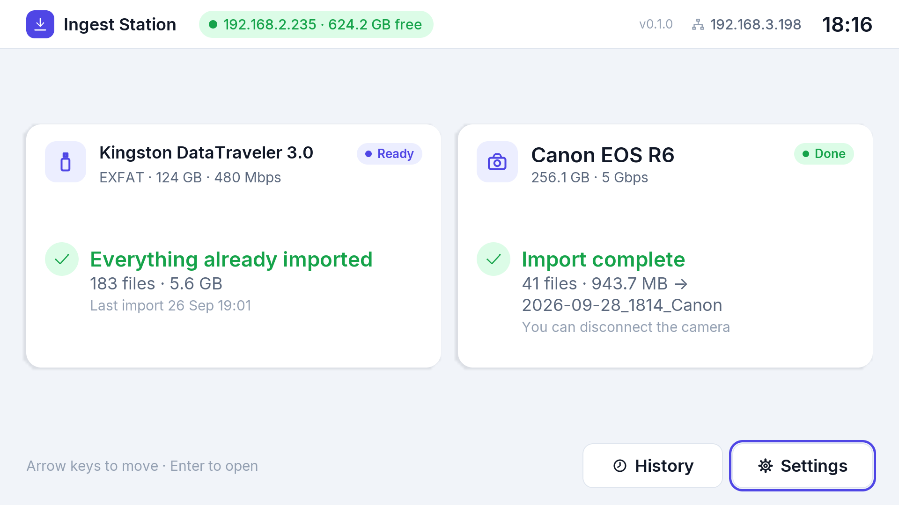
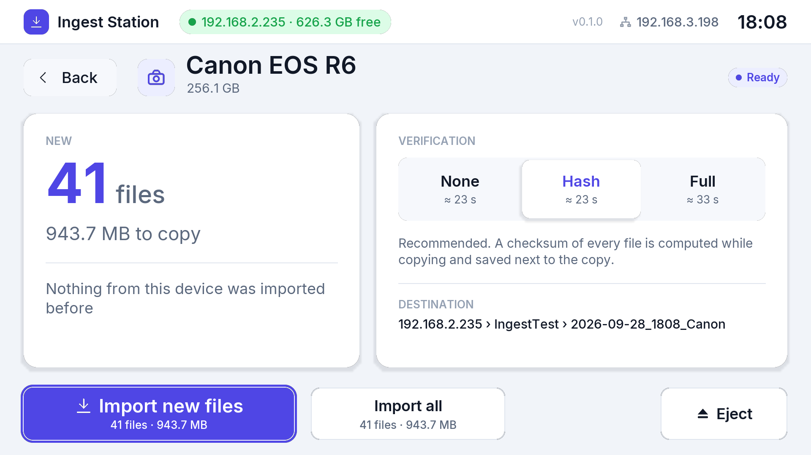
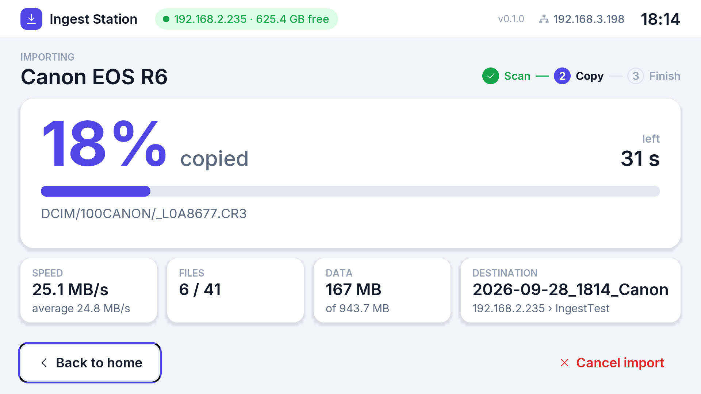
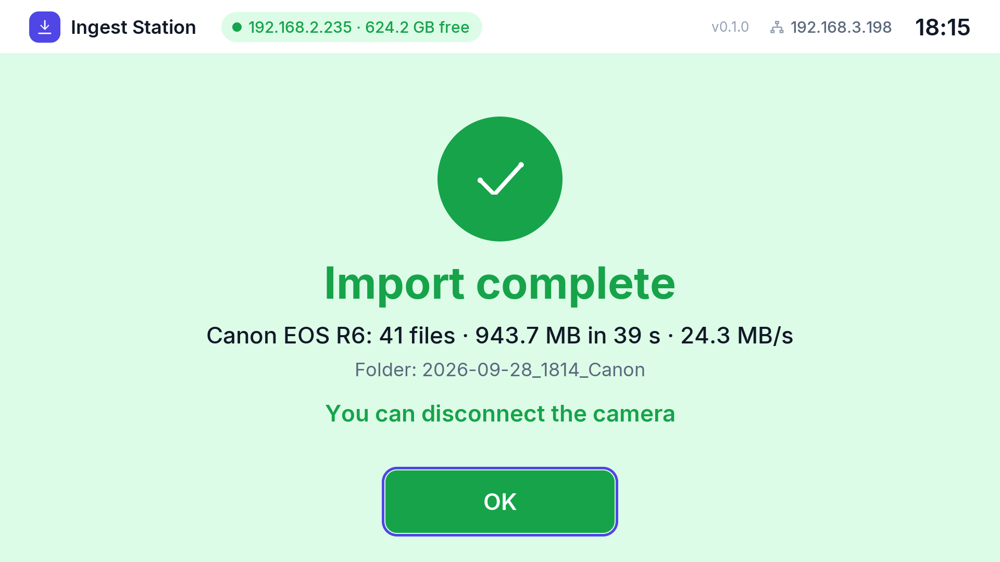
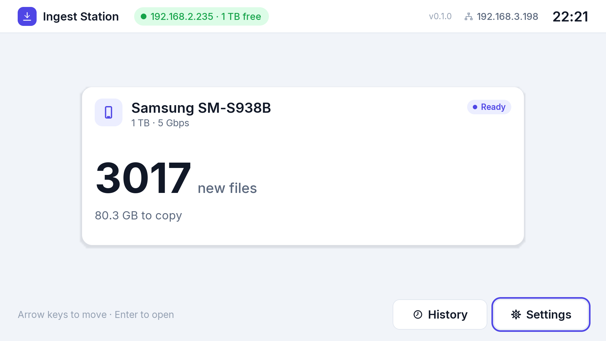
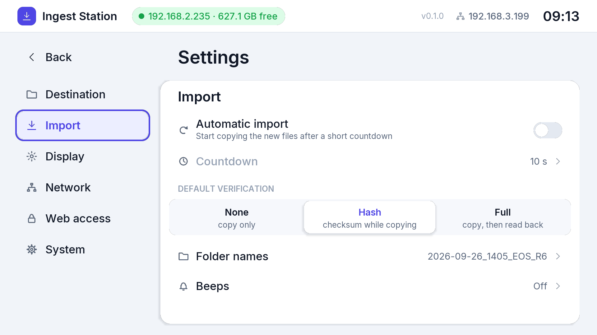

# Ingest Station

**Plug in a card, camera or phone: its photos and videos land on your NAS, verified.**

Ingest Station turns a **Dell Wyse 3040** thin client into a dedicated,
hands-off ingest appliance. Plug in a card reader, a USB stick or disk, a
camera or a phone, and the new files are copied to a network share (NFS or
SMB), verified and indexed, with a touch/keyboard GUI on the monitor.

The goal is fast, reliable offloading without a PC: the station boots in
seconds, recognises what was already imported, and survives power cuts,
because the system runs entirely from RAM and barely writes to its internal
eMMC.

<p align="center">
  
</p>

## What it does

- **Any source**: card readers, USB sticks and disks (exFAT, FAT, NTFS,
  ext4, HFS+), cameras and phones over USB (PTP/MTP). Several at once, with
  an import queue.
- **Any NAS**: NFS or SMB on Synology, QNAP, TrueNAS, Unraid, Windows or
  Linux; protocol version negotiated automatically.
- **Only new files**: already imported files are recognised by fingerprint,
  also across a card reader and the camera's own cable.
- **Verified copies**: xxh128 checksums while copying (saved next to the
  files), or a full read-back from the share.
- **Read-only sources**: devices are set read-only in the kernel before
  mounting; nothing is ever deleted from a card.
- **Robust**: diskless Alpine Linux in RAM, A/B system slots with automatic
  rollback, hardware watchdog; a lost share pauses the import, files already
  copied are always kept.
- **GUI on the monitor**: touch, mouse, keyboard or numeric keypad; pygame on
  KMS/DRM, no X. Light and dark themes, first-boot wizard.
- **Over-the-air updates** from the build PC via SSH, sending only the files
  that changed.
- **Built on Windows with Python only**: pure-Python ISO/SquashFS/cpio; the
  Alpine ISO, package index and every package are verified (GPG, RSA
  signature, hashes).

## Screenshots

<table>
  <tr>
    <td><br><sub>Summary: new files, verification, destination</sub></td>
    <td><br><sub>Import in progress</sub></td>
  </tr>
  <tr>
    <td><br><sub>Result</sub></td>
    <td><br><sub>A phone over MTP</sub></td>
  </tr>
  <tr>
    <td><br><sub>First-boot wizard: connection test</sub></td>
    <td><br><sub>Settings</sub></td>
  </tr>
</table>

## Fast boot

On the Wyse 3040 the GUI is on screen **7.2 s after the kernel starts**
(about 17 s from power-on, 7 s of which are the Dell firmware), down from
~19 s. How: the installed system is cached and restored instead of being
reinstalled at every boot, services start in parallel, slow drivers load in
the background, and the initramfs drops drivers no thin client needs.
Timelines and measurements: [docs/boot-timing.md](docs/boot-timing.md).

## Getting started

You need a **Dell Wyse 3040**, a **FAT32 USB stick** and a **Windows PC with
Python 3.12+**.

1. Prepare the BIOS: UEFI boot, boot from USB enabled, Secure Boot disabled
   ([details](docs/installation.md#1-prepare-the-wyse-3040-bios)).
2. Install the build requirements and build the USB installer:
   ```powershell
   python -m venv .venv
   .venv\Scripts\python -m pip install -r requirements-build.txt
   .venv\Scripts\python build.py
   ```
3. Copy the **content** of `dist/usb/` to the root of the FAT32 stick.
4. Boot the Wyse from the stick with **F12** (if needed: *Boot from file* →
   `EFI\BOOT\BOOTX64.EFI`) and choose **Install Ingest Station to eMMC**.
5. Remove the stick when asked: the station restarts from the eMMC.
6. On the first boot, the wizard asks for the NFS or SMB share and tests the
   connection ([preparing the server](docs/destinations.md)).
7. Plug in a card: review the summary and press **Import new files**.

Full instructions: [docs/installation.md](docs/installation.md).

## Documentation

| Guide | Content |
|---|---|
| [Installation](docs/installation.md) | BIOS, building the installer, USB stick, installing to the eMMC |
| [Destinations](docs/destinations.md) | NFS and SMB requirements, settings per NAS brand |
| [Usage](docs/usage.md) | daily use, verification modes, A/B slots and rollback |
| [Remote access](docs/remote-access.md) | SSH keys, connecting, over-the-air updates |
| [Troubleshooting](docs/troubleshooting.md) | Wyse 3040 quirks, useful console commands |
| [Development](docs/development.md) | repository layout, tools, tests, test NFS server |
| [Architecture](docs/architecture.md) | boot chain, eMMC layout, A/B slots, services, build verification |
| [Boot timing](docs/boot-timing.md) | boot timelines and optimisations |
| [GUI](docs/gui.md) | how the GUI draws, layout rules, developing on the station |

## Status

- **Done**: phase 1 (build, installer, eMMC boot with A/B slots), phase 2
  (ingest daemon: cards, USB disks, cameras and phones; NFS/SMB), phase 3
  (GUI on the monitor).
- **Next**: phase 4, a web UI on the LAN; phase 5, signed update packages.

Changes are listed in [CHANGELOG.md](CHANGELOG.md).
