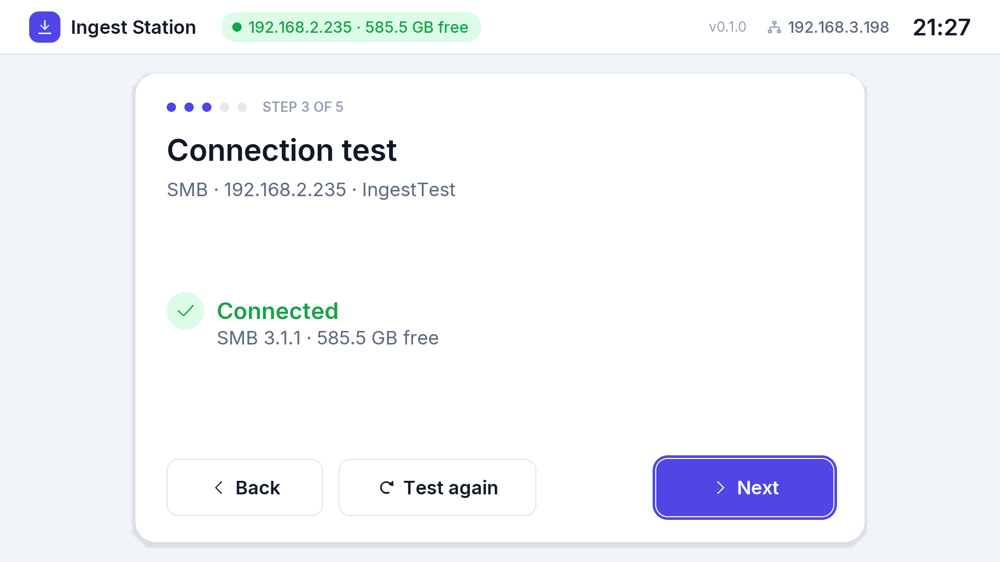

# Destinations (NAS or server)

Any **NFS** or **SMB** server works: a NAS (Synology, QNAP, TrueNAS, Unraid,
Asustor...), a Windows PC, a Linux server.

The destination (type, server, share, folder, credentials) is configured
**from the station's GUI**: the first-boot wizard, then *Settings →
Destination*, with *Test connection* and a folder browser. Over SSH the same
settings are available with `ingestctl share set` (see
[remote-access.md](remote-access.md)).

## General advice

- Create a **dedicated share or folder** for the imports.
- Give the station a **fixed IP address** (DHCP reservation on the router,
  or a static address in the settings): NFS permissions refer to it.
- **NFS** is recommended: it needs the least CPU on the Wyse, so copies are
  faster. **SMB** is simpler where users and passwords are already managed.
- The protocol version is **negotiated automatically** (NFS 4.2 → 4.1 →
  4.0 → 3, SMB 3.1.1 → 3.0 → 2.1) and can be forced in the settings if a
  server misbehaves. SMB1 is not supported.
- If the NAS has an SSD cache, enable it for this share: imports finish
  sooner.

## NFS: what the server must allow

1. Enable the NFS service (version 4 if the server offers it).
2. Export the share **read-write** to the station's IP address.
3. **Root squashing**: the station writes as `root`. Either allow it
   (`no_root_squash`, "No mapping", "Maproot: root") or map every client
   user to an account that can write in the folder (`all_squash` with
   `anonuid`/`anongid`, "Map all users to admin", "Mapall user").
   With the default root squash and no write permission for `nobody`,
   the station reports *cannot write to the share*.
4. On the station: server = NAS address, path = the exported path.

## SMB: what the server must allow

1. Enable SMB 2 or later.
2. Create a user for the station with **read/write** access to the share.
3. Signing and encryption work but cost CPU on the Wyse: if the server
   lets you, leave them optional for this share.
4. On the station: server = address or name, share = share name,
   user/password (stored on the station with permissions `600`), domain only
   for Windows domain accounts.

## Examples

| Server | NFS | SMB |
|---|---|---|
| **Synology DSM** | *Control Panel → File Services → NFS*: enable (max NFSv4.1). *Shared Folder → Edit → NFS Permissions → Create*: host = station IP, *Read/Write*, *Squash: Map all users to admin*, *Security: sys*. Path: `/volume1/<share>`. | *File Services → SMB* (minimum SMB2). User with *Read/Write* on the shared folder. |
| **QNAP QTS** | *Network & File Services → NFS Service*: enable v4. *Shared Folders → Edit Shared Folder Permission → NFS host access*: station IP, *read/write*, squash *NO_ROOT_SQUASH* or all users. Path: as shown by the NAS for the export (e.g. `/<share>`). | *Win/Mac/NFS → Microsoft Networking*, minimum SMB2; user with RW. |
| **TrueNAS** | *Shares → NFS → Add*: path `/mnt/<pool>/<dataset>`, host = station IP, *Maproot User: root* (or *Mapall* to the dataset owner); enable the NFS service with NFSv4. | *Shares → SMB → Add* on the dataset; user with write ACL. |
| **Unraid** | *Settings → NFS*: enable, max version 4. *Shares → <share> → NFS*: Export *Yes*, Security *Private*, rule `IP(sec=sys,rw,all_squash,anonuid=99,anongid=100)`. Path: `/mnt/user/<share>`. | *Settings → SMB*: enable. *Users*: create a user; *Shares → <share> → SMB*: Security *Private*, user *Read/Write*. |
| **Windows** | (not built in) | Folder *Properties → Sharing → Advanced Sharing*: share it, permissions *Change* for a local user (a Microsoft account also works, user = e-mail address); the NTFS permissions must allow writing. |
| **Linux** | `/etc/exports`: `/srv/ingest IP(rw,sync,no_subtree_check,all_squash,anonuid=1000,anongid=1000)`, then `exportfs -ra`. | Samba share with `read only = no` and a user added with `smbpasswd -a`. |

## Testing without a NAS

A test NFSv4 server (NFS-Ganesha in Docker) is in
[tests/nfs-server/](../tests/nfs-server/README.md), see
[development.md](development.md#test-nfs-server).
